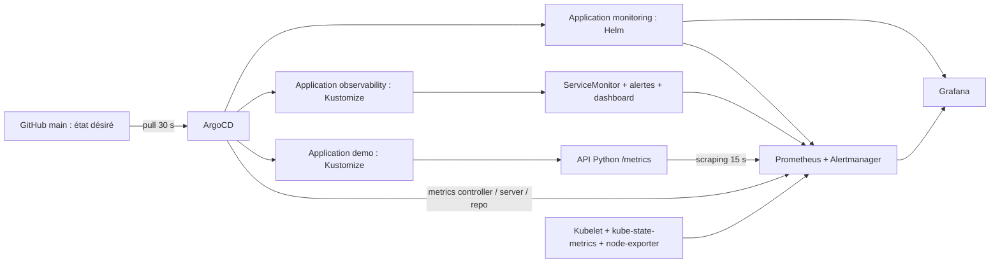

# TP4 — GitOps, ArgoCD et observabilité

Solution : API Python instrumentée, Kustomize base/overlay, ArgoCD auto-sync/self-heal/prune, kube-prometheus-stack pilotée par ArgoCD, quatre ServiceMonitor, trois alertes et dashboard Grafana JSON de 14 panneaux.

- [Guide des cinq scénarios de soutenance](docs/SOUTENANCE.md)
- [Rapport technique](docs/RAPPORT.md)
- [Résultats des validations](docs/VALIDATION.md)

## Architecture



Trois Applications indépendantes évitent qu'un parent réactive l'auto-sync de demo pendant un rollback. Le bootstrap utilise kubectl pour installer ArgoCD et déclarer les Applications. Les déploiements suivants sont tirés de Git. Le bootstrap ArgoCD est décrit dans Git ; son installation/mise à jour reste une étape administrative explicite.

## Organisation

| Chemin | Rôle |
|---|---|
| bootstrap/argocd | Installation versionnée et intervalle de réconciliation |
| argocd | Trois ressources Application |
| apps/demo/base | API, Deployment, Service et ConfigMap à hash |
| apps/demo/overlays/dev | Répliques et image pour la démonstration |
| monitoring/values.yaml | Valeurs Helm de la stack |
| observability | ServiceMonitor, PrometheusRule, dashboard provisionné |
| scripts | Bootstrap, accès, charge, démonstration et tests |

## Installation Windows

Prérequis : Docker Desktop Linux actif, Git, kubectl, kind, Python 3.12+. Aucun Helm local requis : ArgoCD rend le chart. Prévoir environ 4 CPU et 8 Go de RAM pour Docker et l'accès Internet aux registries. Profil Kind/Kubernetes 1.32.2, ArgoCD 2.14.11, kube-prometheus-stack 69.8.2. Versions de référence du laboratoire à mettre à niveau avant un usage de production.

Dépôt : https://github.com/eyamakni/tp4-devops.git, branche main. Les fichiers doivent être poussés avant le bootstrap. En cas de changement de dépôt, adapter les repoURL Git dans argocd/*.yaml et pousser.

```powershell
powershell -ExecutionPolicy Bypass -File scripts/bootstrap.ps1 -CreateCluster
# Cluster existant : choisir explicitement son contexte
# powershell -ExecutionPolicy Bypass -File scripts/bootstrap.ps1 -Context kind-devops-tp
kubectl -n argocd get applications -w
```

Le script attend les CRD Prometheus avant de créer observability. Attendre ensuite Synced/Healthy pour les trois Applications. S'il dépasse le délai de téléchargement, examiner monitoring dans ArgoCD puis relancer.

Ouvrir un terminal par service et garder ces processus ouverts :

```powershell
powershell -File scripts/access.ps1 argocd
powershell -File scripts/access.ps1 grafana
powershell -File scripts/access.ps1 prometheus
powershell -File scripts/access.ps1 alertmanager
powershell -File scripts/access.ps1 demo
```

| Service | Adresse | Utilisateur |
|---|---|---|
| ArgoCD | https://localhost:8080 | admin |
| Grafana | http://localhost:3001 | admin |
| Prometheus | http://localhost:9090 | accès local |
| Alertmanager | http://localhost:9093 | accès local |
| API | http://localhost:8081 | /, /healthz, /metrics, /error |

ArgoCD utilise un certificat autosigné pour ce laboratoire. Lire les mots de passe générés sans les commiter :

```powershell
$s = kubectl -n argocd get secret argocd-initial-admin-secret -o jsonpath='{.data.password}'
[Text.Encoding]::UTF8.GetString([Convert]::FromBase64String($s))
$s = kubectl -n monitoring get secret monitoring-grafana -o jsonpath='{.data.admin-password}'
[Text.Encoding]::UTF8.GetString([Convert]::FromBase64String($s))
```

Grafana : ouvrir **TP4 - GitOps et observabilite**, sélectionner Prometheus si nécessaire. Le chart configure cette source automatiquement. Prometheus Status / Targets : vérifier controller, server, repo-server et demo (une cible par pod). Alerts : groupe tp4.gitops.

## PromQL

Les requêtes complètes sont aussi dans le JSON du dashboard.

| Besoin | Requête |
|---|---|
| Sync / Health | `argocd_app_info{name="demo"}` : labels sync_status et health_status |
| Synchronisations | `sum by (name, phase) (increase(argocd_app_sync_total{name="demo"}[5m]))` |
| Appels Git | `sum by (request_type) (rate(argocd_git_request_total[5m]))` |
| Répliques désirées | `kube_deployment_spec_replicas{namespace="demo",deployment="demo"}` |
| Disponibles | `kube_deployment_status_replicas_available{namespace="demo",deployment="demo"}` |
| Indisponibles | `kube_deployment_status_replicas_unavailable{namespace="demo",deployment="demo"}` |
| CPU (cœurs) | `sum by (pod) (rate(container_cpu_usage_seconds_total{namespace="demo",container="demo"}[2m]))` |
| Mémoire (octets) | `sum by (pod) (container_memory_working_set_bytes{namespace="demo",container="demo"})` |
| Redémarrages / 5 min | `sum by (pod) (increase(kube_pod_container_status_restarts_total{namespace="demo"}[5m]))` |
| Débit HTTP | `sum(rate(tp4_http_requests_total[2m])) or vector(0)` |
| Erreurs 5xx (%) | `100 * (sum(rate(tp4_http_requests_total{status=~"5.."}[2m])) or vector(0)) / clamp_min(sum(rate(tp4_http_requests_total[2m])) or vector(0), 0.001)` |
| Latence moyenne (s) | `sum(rate(tp4_http_request_duration_seconds_sum[2m])) / clamp_min(sum(rate(tp4_http_request_duration_seconds_count[2m])), 0.001)` |
| Alertes | `ALERTS{alertname=~"ArgoCDApplication.*|DemoContainerBlocked"}` |

Les annotations de sync utilisent une fenêtre : elles sont approximatives et peuvent dupliquer un marqueur. L'historique ArgoCD fait référence pour le commit et l'heure exacte. Les compteurs repartent à zéro au redémarrage ; rate/increase traitent ces resets. Attendre au moins deux scrapes et générer du trafic. L'absence de série ne prouve pas la bonne santé. La latence instrumentée mesure la préparation de la réponse, sans transfert réseau.

## Alertes

ArgoCDApplicationDegraded et ArgoCDApplicationOutOfSync : état persistant 2 min. DemoContainerBlocked : ImagePullBackOff, ErrImagePull ou CrashLoopBackOff pendant 2 min. États Prometheus : Inactive → Pending → Firing → Inactive. Le sujet appelle aussi le retour normal « Normal ». Ces règles sont gérées par Prometheus ; Alertmanager affiche les alertes actives. Aucun email/Slack : receiver local sans intégration externe.

## Vérifications et limites

```powershell
python -B scripts/validate.py
kubectl kustomize apps/demo/overlays/dev
kubectl kustomize observability
kubectl -n argocd get applications
kubectl -n demo rollout status deployment/demo --timeout=180s
kubectl -n monitoring get servicemonitors,prometheusrules
```

L'API est fournie par ConfigMap pour éviter un registry personnel. Son hash déclenche le rollout à chaque changement. En production : image immuable, signée, identifiée par digest. Les anciens pods peuvent continuer à servir pendant une erreur de téléchargement d'image ; un ImagePullBackOff n'implique pas de redémarrage.

Profil local : stockage éphémère, pas de HA ni notification externe, projet ArgoCD default permissif, endpoints control plane non exposés par Kind désactivés. En production : versions maintenues, stockage persistant, SSO/TLS, projets/RBAC minimaux, NetworkPolicy et secrets externes. Les port-forward sont liés à 127.0.0.1. Ne jamais commiter de credentials ni de captures contenant des secrets.

## Références officielles

- [Auto-sync et restriction du rollback](https://argo-cd.readthedocs.io/en/stable/user-guide/auto_sync/)
- [Métriques ArgoCD](https://argo-cd.readthedocs.io/en/stable/operator-manual/metrics/)
- [Chart versionné](https://github.com/prometheus-community/helm-charts/tree/kube-prometheus-stack-69.8.2/charts/kube-prometheus-stack)
- [Kustomize](https://kubernetes.io/docs/tasks/manage-kubernetes-objects/kustomization/)

## Vérification fonctionnelle et répétition automatisée

Après le bootstrap, on peut lancer tous les port-forward dans des processus cachés :

```powershell
powershell -File scripts/start-access.ps1
python -B scripts/verify-observability.py
```

Les logs sont dans artifacts/. Ces accès sont temporaires et doivent être relancés après un redémarrage. Ne pas lancer plusieurs fois sur les mêmes ports.

Pour répéter réellement les scénarios sur kind-tp4-gitops :

```powershell
python -B scripts/rehearse.py
```

Cette commande crée et pousse des commits, déclenche une panne volontaire, attend Firing, effectue le rollback via l'API ArgoCD, revert la panne et restaure deux répliques. Exiger un dépôt sans modifications locales. Les preuves horodatées vont dans artifacts/rehearsal.json. Le rollback API est équivalent à l'action du contrôleur mais ne remplace pas la démonstration UI à effectuer lors de la soutenance.
